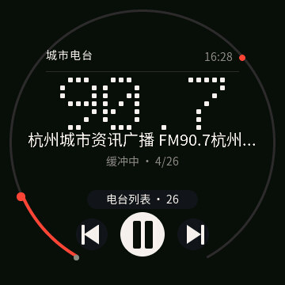
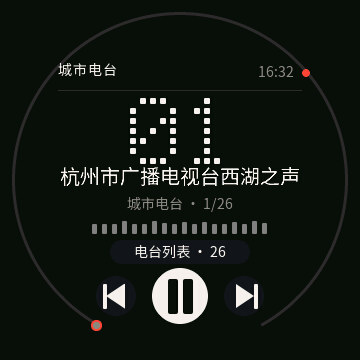
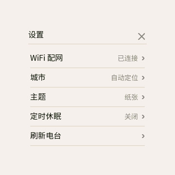
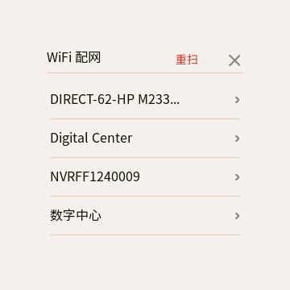

# SDGOODS Radio · 谷仓次元屏桌面网络电台

把谷仓次元屏（ESP32-S3 · 360×360 圆屏）变成一台**桌面网络收音机**：
连 WiFi 播城市网络电台，5×7 点阵大字 + 圆屏刻度环，触摸拖拽换台，无限曲库、零存储占用。

| 纸张主题 | 夜色主题 | 播放态 |
| --- | --- | --- |
|  |  |  |

| 电台列表 | 设置 | WiFi 配网 |
| --- | --- | --- |
|  |  |  |

## 特性

* **一个英雄元素**：自绘 5×7 点阵大字。有 FM 频率显示频率（`90.7`），纯网络台显示频道号（`07`），
  不再出现 `--.- MHz` 这种「像坏了」的空主视觉。
* **单色 + 一个点缀色**：纸张 `#F4F1E8` / 夜色 `#0C0C0D` 双主题，红色只用于「正在直播」的进度与端点。
* **拖拽调台**：横向拖动连续预览（点阵/台名/环同步），松手才起播；点空白播放/暂停。
* **城市电台**：按城市查 Radio Browser（`hidebroken=true` + 编码过滤），自动定位失败退内置精选。
* **全部自绘**：图标是 `lv_draw_*` 矢量，不依赖图标字体；不占 canvas 缓冲。
* **中文字形覆盖**：界面文案用 `cn_font_16`，网络台名用 `net_font_20`（GB2312 一级 3755 字），不会出现 `?`。

## 目录结构

```
sdgoods-radio/
├── main/                    # 应用层
│   ├── apps/
│   │   ├── ui_radio.c       # 主屏：布局 / 拖拽调台 / tick / 串口诊断键
│   │   ├── ui_radio_kit.*   # 设计系统：主题 token、点阵、刻度环、图标、页面骨架
│   │   └── ui_radio_pages.* # 列表 / 设置 / 选择器 / WiFi 配网
│   ├── radio_player.c       # 生产者(HTTP) + 消费者(解码→I2S)，64KB PSRAM 环形缓冲
│   ├── radio_catalog.c      # 城市电台目录（查询 / 去重 / 编码过滤）
│   ├── radio_settings.c     # NVS：城市、主题、定时休眠、续播索引
│   └── wifi_prov.c          # WiFi 配网（扫描 / 连接 / AP 兜底）
├── components/              # 平台组件（sdgoods_board / launcher / dns_server / jpegenc）
├── platform/prebuilt/       # 平台引导层预编译 bin
├── tools/                   # 字体生成、截屏、打包、发布脚本
├── docs/                    # 全部文档（见下方索引）
└── sdgoods-ai/              # 平台 AI skill 与 MCP 说明
```

## 构建与烧录

```powershell
# 本机 ESP-IDF 5.5.3 在 C:\Users\shea_\esp\esp-idf，工具链在 D:\1.Soft\Espressif
$env:IDF_TOOLS_PATH='D:\1.Soft\Espressif'
$env:IDF_PATH='C:\Users\shea_\esp\esp-idf'
$env:IDF_PYTHON_ENV_PATH='D:\1.Soft\Espressif\python_env\idf5.5_py3.11_env'
$env:PATH="$env:IDF_PYTHON_ENV_PATH\Scripts;$env:IDF_PATH\tools;$env:PATH"
. 'C:\Users\shea_\esp\esp-idf\export.ps1'

idf.py build
idf.py -p COM6 flash
```

产物：`build/SDGOODS_RADIO.bin`（app 分区 3MB，当前约 2.92MB / 剩 7%）。

**新增中文文案后必须重跑字体**，否则新字会显示成 `?`：

```powershell
python tools\gen_fonts.py --sizes 14,16 --net-size 20 --net-bpp 2 `
    --bin "node_modules\.bin\lv_font_conv.cmd"
```

## 真机验收（无键鼠）

固件覆盖了平台弱符号 `sdgoods_console_ext_cmd()`，串口发单字母即可走**合成触摸**的完整点按链路：

| 键 | 行为 |
| --- | --- |
| `l` / `k` | 开列表 / 开设置 |
| `w` | 点设置首行 → WiFi 配网 |
| `n` / `x` | 切主题 / 关页面回主屏 |
| `1`–`9` | 播第 N 台 |

```powershell
python tools\screenshot_recv.py -p COM6 -t --pre "x,k,w" --pre-boot 12 --pre-gap 3 --wait 5 `
       -o docs\shots\page_wifi.jpg
```

> 打开串口会拉 DTR 导致复位，`--pre-boot` 要 ≥12s，键间靠 `--pre-gap` 留出建页时间。

## 文档

| 文档 | 内容 |
| --- | --- |
| [docs/UI_REDESIGN.md](docs/UI_REDESIGN.md) | 设计系统与交互规格：色板、字体层级、圆屏安全区、布局像素表、状态文案 |
| [docs/DEVLOG.md](docs/DEVLOG.md) | 重构过程记录：病灶清单、文件职责、关键坑（PSRAM 栈 / tick=0 看门狗 / 缺字 / LONG_DOT …）、验收表 |
| [docs/ARCHITECTURE.md](docs/ARCHITECTURE.md) | 技术方案：播放链路、平台适配点、风险 |
| [docs/PLAN.md](docs/PLAN.md) | 实行计划与里程碑 |
| [docs/PLATFORM.md](docs/PLATFORM.md) | 上游平台工程说明（谷仓次元屏二次开发基座，含许可与商标声明） |
| [docs/PLATFORM_ARCHITECTURE.md](docs/PLATFORM_ARCHITECTURE.md) | 平台架构（多应用槽 / 启动器 / 组件边界） |

其余 `docs/*.md` 为平台侧文档（APP_SDK / BUILD / PUBLISHING / MCP_CONTRACT …）；
历史调试日志与旧截图收在 `docs/archive/`。

## 已知问题

见 [DEVLOG.md §6](docs/DEVLOG.md)：部分 CN 台源已失效（重连 2 次 → 自动跳下一台 → 连续 3 台失败停下）、
部分台名自带 `FM90.7…` 与英雄位重复、圆屏列表页无滚动指示。

## 许可

平台层与应用层均为 Apache-2.0，详见 `LICENSE` / `LICENSING.md`；
**项目名、产品名与 SDGOODS 标识不在代码许可授权范围内**（见 `TRADEMARK.md`）。
