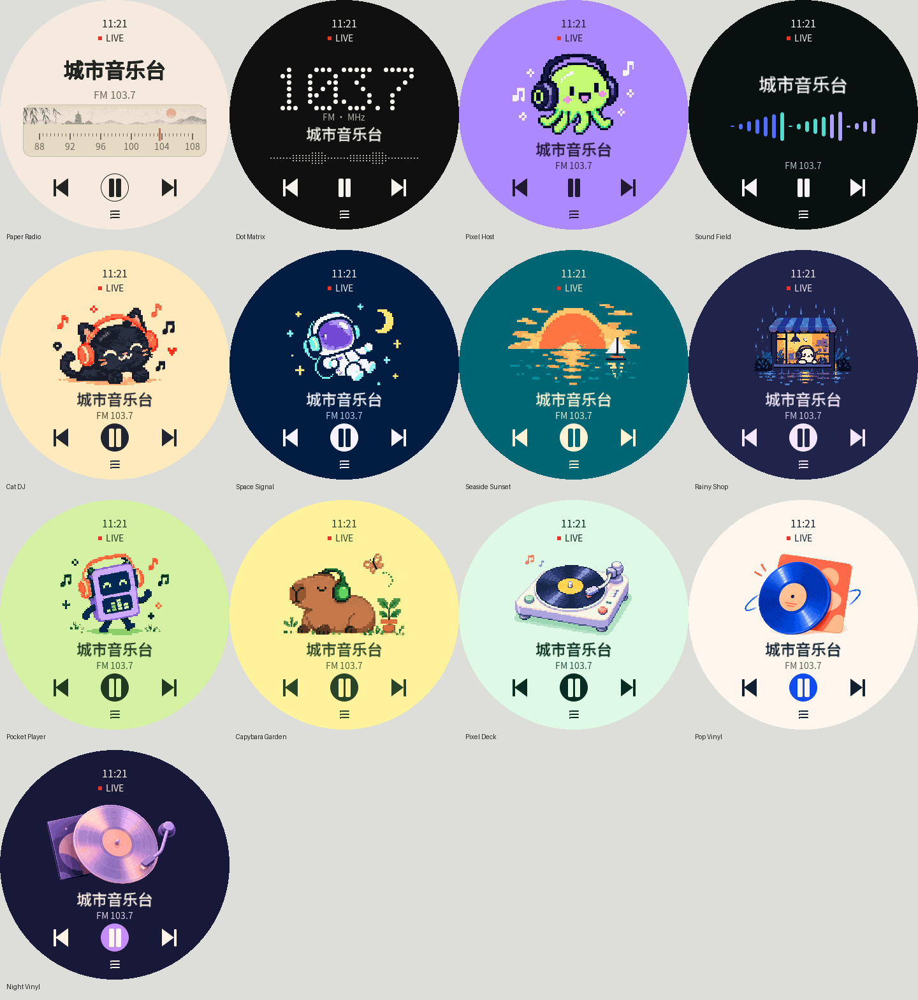
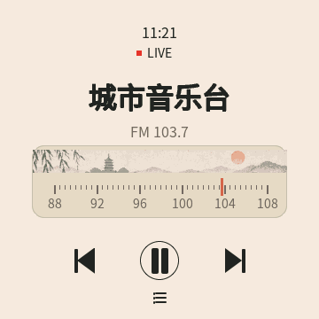
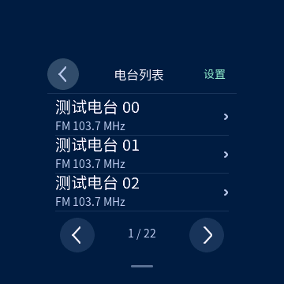

# SDGOODS Radio · 谷仓次元屏桌面网络电台

把谷仓次元屏（ESP32-S3 · 360×360 圆屏）变成一台**桌面网络收音机**：
连 WiFi 播城市网络电台，**13 套可切换的皮肤**（多套带常驻动效），触摸滑动手势换台换肤，
目录与播放依赖网络，图片和字体随应用固件存储。本仓库 = **谷仓 SDGOODS 平台基座** + **radio 演示应用**（`main/`），是平台二次开发的完整参考实现。

| 13 套皮肤总览 | 动效演示 | 真机 |
| --- | --- | --- |
|  |  |  |

| 纸感收音机 | 选台页 | WiFi 配网（中央大键盘） |
| --- | --- | --- |
|  |  |  |

## 特性

* **13 套皮肤，主屏左右滑即换**：纸感收音机、点阵电波、像素主播、声波极简、猫咪 DJ、太空电波、
  海边落日、雨夜便利店、掌机音乐盒、像素花园 + 三款唱片主题，首尾循环、选择持久化。
  多套带常驻动效：暂停/缓冲时继续动，进入二级页冻结，返回接着动。
* **点按切台 + 滑动手势**：左右箭头切相邻台（首尾循环），主屏上滑开选台页（每页 3 条、左右滑翻页，最多 64 台），
  顶部下滑开平台控制中心；不与设备级导航抢手势。
* **城市电台目录**：联网后按城市查 Radio Browser（去重 + 编码过滤，上限 64 条），全部目录查询均无结果时退内置 3 台兜底；
  流媒体超时和重试由播放器处理，最终失败时显示重试提示。
* **台名与频率识别**：品牌短名 + 已知 FM 频率映射（如西湖之声 FM 105.4）；没有可靠频率的网络台
  显示目录编号（`CH 03` / 「网络频道」），**不编造 MHz**。
* **MP3 / AAC 双解码**：独立网络生产者 + 解码消费者任务，64KB PSRAM 环形缓冲，302 跟跳，
  采样率/声道运行时自适应，解不出自动改判兜底。
* **圆屏软键盘**：WiFi 密码用中央分页大键盘（5×3 字符区），覆盖全部 95 个可打印 ASCII，所有按键收进中央区域，物理触摸手感仍需真机验证。
* **动态界面与 AI 素材结合**：图标是 `lv_draw_*` 矢量，角色/场景是低色数索引素材 + LVGL 时钟驱动，不依赖图标字体与帧序列。
* **中英双语**：应用启动默认中文，保留中英文文案；中文字形覆盖经逐字校验，台名走 GB2312 一级子集，罕见字仍可能降级显示。

## 操作速查

| 手势 / 位置 | 行为 |
| --- | --- |
| 主屏**左/右滑** | 左滑下一套 / 右滑上一套皮肤（松手切换并保存） |
| 主屏**上滑** 或底部列表图标 | 打开选台页；列表再次上滑返回主屏（不打断播放） |
| 底部**左右箭头** | 上一台 / 下一台（首尾循环） |
| 中间**播放键** | 暂停 / 恢复；失败后点按按缓存 URL 重试原台 |
| 选台页**左右滑** | 翻页（每页 3 条） |
| **顶部下滑** | 平台控制中心（音量/静音、亮度、电量、语言、电源） |
| 设置页 | WiFi、城市、外观（预览→应用）、定时休眠、刷新电台 |

完整规则（手势隔离、失败表现、皮肤与播放解耦等）见
[docs/radio/RADIO_OPERATIONS.md](docs/radio/RADIO_OPERATIONS.md)。

## 目录结构

```
sdgoods-radio/
├── main/                        # 应用层（radio 应用全在这里）
│   ├── main.c                   # 装配点：初始化平台 + apps_register()
│   ├── apps/
│   │   ├── ui_radio.c           # 主屏：布局 / 手势编排 / 播放状态机对接
│   │   ├── ui_radio_skin.*      # 13 套皮肤注册表与渲染（左右滑切肤）
│   │   ├── ui_radio_kit.*       # 设计系统：主题 token、点阵、图标、圆按钮、页面骨架
│   │   ├── ui_radio_pages.*     # 选台 / 设置 / 城市 / 外观 / WiFi 配网页
│   │   ├── ui_radio_assets.*    # 角色图集素材（索引色 C 数组）
│   │   ├── ui_radio_redraw_assets.*  # 纸感场景与三款唱片素材
│   │   ├── ui_radio_title_font.c     # 台名高分辨率标题字体子集
│   │   └── apps_registry.c      # 应用注册表（当前仅 radio）
│   ├── radio_player.c           # 播放器：生产者(HTTP) + 消费者(解码→I2S)，64KB PSRAM 环形缓冲
│   ├── radio_catalog.c          # Radio Browser 城市目录（查询/去重/编码过滤/兜底）
│   ├── radio_station_identity.c # 台名短名与已知 FM 频率映射
│   ├── radio_settings.c         # NVS：城市、皮肤、定时休眠、续播索引
│   ├── wifi_prov.c              # WiFi 配网（扫描 / 连接 / AP 兜底）
│   └── app_data_store.c         # 持久数据存储参考实现（NVS）
├── components/                  # 平台组件（sdgoods_board BSP / launcher / dns_server / jpegenc）
├── platform/prebuilt/           # 平台官方引导层预编译 bin（本地烧录用，勿改）
├── tools/                       # 构建、字体、主机回归、截屏、打包、发布脚本（见下）
├── docs/                        # 平台基座文档 + radio/（应用文档、设计档案与截图）
└── sdgoods-ai/                  # 平台 AI skill 与 MCP server
```

## 构建与烧录

已安装并激活 **ESP-IDF 5.5** 后，在仓库根目录执行：

```bash
idf.py build
bash tools/flash_local.sh -b build -p COM6
```

`COM6` 换成实际串口。Windows 可在已激活 IDF 的 Git Bash 中执行；首次安装环境见
[环境说明](docs/ENVIRONMENT.md)。日常改代码、重新烧录只需以上两步。
脚本自动写入 `platform/prebuilt/` 的官方引导层和刚生成的 `build/SDGOODS_RADIO.bin`。

也可用现有封装一条命令完成（默认构建目录为 `build_pub`）：

```bash
bash tools/build.sh flash -p COM6
```

串口被占用时，先关闭使用它的串口监视器或网页。本地脚本会写引导层、分区表和 factory 应用区，
已有多应用设备应通过平台安装应用包，安装流程见 [发布说明](docs/radio/RELEASE.md)。

<details>
<summary>首次配置、字体与开发自测（按需执行）</summary>

首次配置或环境有问题时运行 `python tools/check_env.py`；更换芯片目标才需要重新设置 target。
增加中文字符后再生成字体，字体源码已经随仓库提供，普通构建不用每次重跑：

```bash
python tools/gen_fonts.py --bin ./node_modules/.bin/lv_font_conv
python tools/gen_fonts.py --check
python tools/font_metrics.py
```

Windows 的转换器路径使用 `node_modules/.bin/lv_font_conv.cmd`。完整字体说明见
[环境说明](docs/ENVIRONMENT.md)。

开发自测入口：

```bash
python tools/radio/check_project_layout.py
python tools/radio/check_radio_keyboard.py
python tools/radio/test_radio_host.py
python tools/screenshot_recv.py -p COM6 -o output/shot.png -t
```

主机渲染需要原生 gcc 与 Pillow，输出位于 `output/radio-host-current/`；它属于开发验证，
不是普通构建的前置步骤。串口截图需要连接设备。应用包大小以本次构建结果为准，平台上限为
3,040,870 B（2.9 MiB），不要沿用旧版本的余量百分比。

</details>

## 发布到谷仓开放平台

完整管线（环境自检 → 字体 → 主机回归 → 编译 → 应用包校验 → 组装 dist → 平台上传 / GitHub Release）
见 **[docs/radio/RELEASE.md](docs/radio/RELEASE.md)**。

## 文档索引

**Radio 应用（docs/radio/）**——全部清单见 [docs/radio/README.md](docs/radio/README.md)，常用的：

| 文档 | 内容 |
| --- | --- |
| [RADIO_OPERATIONS.md](docs/radio/RADIO_OPERATIONS.md) | 操作清单：手势、页面、状态与失败表现 |
| [RELEASE.md](docs/radio/RELEASE.md) | 发布手册：全流程命令 |
| [DEVLOG.md](docs/radio/DEVLOG.md) | 重构过程史：病灶、关键坑、验收（至 10-27） |

**平台基座（docs/ 根）**：[PLATFORM.md](docs/PLATFORM.md)（平台说明）·
[PLATFORM_ARCHITECTURE.md](docs/PLATFORM_ARCHITECTURE.md)（平台架构）·
[APP_SDK.md](docs/APP_SDK.md)（应用 SDK）·
[BUILD.md](docs/BUILD.md) · [ENVIRONMENT.md](docs/ENVIRONMENT.md) ·
[PUBLISHING.md](docs/PUBLISHING.md) · [MCP_CONTRACT.md](docs/MCP_CONTRACT.md) ·
[MULTI_APP_DYNAMIC_SLOTS.md](docs/MULTI_APP_DYNAMIC_SLOTS.md) ·
[SINGLE_APP_FIRMWARE.md](docs/SINGLE_APP_FIRMWARE.md) ·
[STANDALONE_PROJECT.md](docs/STANDALONE_PROJECT.md)（派生独立工程）

设计档案与验收图：[docs/radio/design/](docs/radio/design/README.md)。

## 当前状态与已知问题

- 当前源码版本以 `version.txt` 为准（目前为 **1.1.0**），包含 13 套风格。历史构建、发布包、真机截图不能证明当前源码已完成验收，参见 [收尾记录与待办](docs/radio/STATUS.md)。
- **待真机长期验收**：物理触控手感、持续音频质量、长时间稳定性——主机回归不能替代这些。
- 部分 CN 台源已失效或仅服务本地网络，靠「重连 2 次 → 跳台 → 连续 3 台失败停下」策略兜底；
  台源连通性记忆、收藏 / 节目单 / ICY 曲名未做（见
  [RADIO_STREAMING_PLAN.md](docs/radio/RADIO_STREAMING_PLAN.md)）。
- 纸感贴图圆角仍有用户反馈待关闭：需要确认设备实际固件版本并抓取 COM6 新截图；本轮未连接设备。

## 许可与归属

平台层与应用层均为 Apache-2.0，详见 `LICENSE` / `LICENSING.md`；中文字形来自
Noto Sans SC（SIL OFL 1.1，见 `components/sdgoods_board/fonts/OFL.txt`）。
**项目名、产品名与 SDGOODS 标识不在代码许可授权范围内**（见 `TRADEMARK.md`）。
本工程基于谷仓 SDGOODS 开放平台基础工程：[https://sdgoods.ai](https://sdgoods.ai)。
