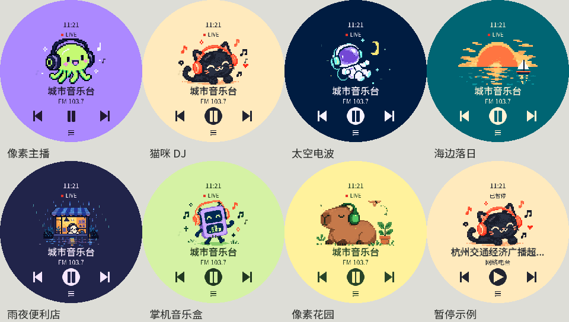
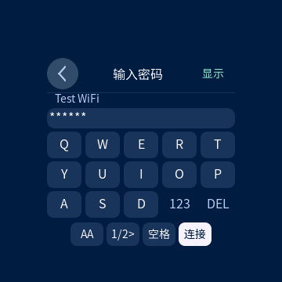

# SDGOODS Radio · 谷仓次元屏桌面网络电台

把谷仓次元屏（ESP32-S3 · 360×360 圆屏）变成一台**桌面网络收音机**：
连 WiFi 播城市网络电台，**13 套可切换的像素皮肤**（多套带常驻动效），触摸滑动手势换台换肤，
无限曲库、零存储占用。本仓库 = **谷仓 SDGOODS 平台基座** + **radio 演示应用**（`main/`），是平台二次开发的完整参考实现。

| 13 套皮肤总览 | 动效演示 | 真机 |
| --- | --- | --- |
|  |  |  |

| 纸感收音机 | 选台页 | WiFi 配网（中央大键盘） |
| --- | --- | --- |
|  |  |  |

## 特性

* **13 套皮肤，主屏左右滑即换**：纸感收音机、点阵电波、像素主播、声波极简、猫咪 DJ、太空电波、
  海边落日、雨夜便利店、掌机音乐盒、像素花园 + 三款像素唱片，首尾循环、选择持久化。
  多套带常驻动效：暂停/缓冲时继续动，进入二级页冻结，返回接着动。
* **拖拽调台 + 滑动手势**：左右箭头切相邻台（首尾循环），主屏上滑开选台页（每页 3 条、左右滑翻页，最多 64 台），
  顶部下滑开平台控制中心；不与设备级导航抢手势。
* **城市电台目录**：联网后按城市查 Radio Browser（去重 + 编码过滤，上限 64 条），定位失败退内置 3 台兜底；
  连播失败自动跳台，重连 2 次跳下一台、连续 3 台失败停下，12s 首帧看门狗防无限「缓冲中」。
* **台名与频率识别**：品牌短名 + 已知 FM 频率映射（如西湖之声 FM 105.4）；没有可靠频率的网络台
  显示目录编号（`CH 03` / 「网络频道」），**不编造 MHz**。
* **MP3 / AAC 双解码**：独立网络生产者 + 解码消费者任务，64KB PSRAM 环形缓冲，302 跟跳，
  采样率/声道运行时自适应，解不出自动改判兜底。
* **圆屏软键盘**：WiFi 密码用中央分页大键盘（5×3 字符区），覆盖全部 95 个可打印 ASCII，边缘无难点键。
* **全部自绘**：图标是 `lv_draw_*` 矢量，角色/场景是低色数索引素材 + LVGL 时钟驱动，不依赖图标字体与帧序列。
* **中英双语**：界面文案跟随平台语言设置；中文字形覆盖经逐字校验，台名走 GB2312 一级子集，不会出现 `?`。

## 操作速查

| 手势 / 位置 | 行为 |
| --- | --- |
| 主屏**左/右滑** | 上一套 / 下一套皮肤（松手切换并保存） |
| 主屏**上滑** 或底部列表图标 | 打开选台页；列表再次上滑返回主屏（不打断播放） |
| 底部**左右箭头** | 上一台 / 下一台（首尾循环） |
| 中间**播放键** | 暂停 / 恢复；失败后点按按缓存 URL 重试原台 |
| 选台页**左右滑** | 翻页（每页 3 条） |
| **顶部下滑** | 平台控制中心（音量/静音、亮度、电量、语言、电源） |
| 设置页 | WiFi、城市、外观（预览→应用）、定时休眠、刷新电台 |

完整规则（手势隔离、失败表现、皮肤与播放解耦等）见
[docs/radio/RADIO_OPERATIONS.md](docs/radio/RADIO_OPERATIONS.md)。

## 目录结构

```
sdgoods-radio/
├── main/                        # 应用层（radio 应用全在这里）
│   ├── main.c                   # 装配点：初始化平台 + apps_register()
│   ├── apps/
│   │   ├── ui_radio.c           # 主屏：布局 / 手势编排 / 播放状态机对接
│   │   ├── ui_radio_skin.*      # 13 套皮肤注册表与渲染（左右滑切肤）
│   │   ├── ui_radio_kit.*       # 设计系统：主题 token、点阵、图标、圆按钮、页面骨架
│   │   ├── ui_radio_pages.*     # 选台 / 设置 / 城市 / 外观 / WiFi 配网页
│   │   ├── ui_radio_assets.*    # 角色图集素材（索引色 C 数组）
│   │   ├── ui_radio_redraw_assets.*  # 纸感场景与三款唱片素材
│   │   ├── ui_radio_title_font.c     # 台名高分辨率标题字体子集
│   │   └── apps_registry.c      # 应用注册表（当前仅 radio）
│   ├── radio_player.c           # 播放器：生产者(HTTP) + 消费者(解码→I2S)，64KB PSRAM 环形缓冲
│   ├── radio_catalog.c          # Radio Browser 城市目录（查询/去重/编码过滤/兜底）
│   ├── radio_station_identity.c # 台名短名与已知 FM 频率映射
│   ├── radio_settings.c         # NVS：城市、皮肤、定时休眠、续播索引
│   ├── wifi_prov.c              # WiFi 配网（扫描 / 连接 / AP 兜底）
│   └── app_data_store.c         # 持久数据存储参考实现（NVS）
├── components/                  # 平台组件（sdgoods_board BSP / launcher / dns_server / jpegenc）
├── platform/prebuilt/           # 平台官方引导层预编译 bin（本地烧录用，勿改）
├── tools/                       # 构建、字体、主机回归、截屏、打包、发布脚本（见下）
├── docs/                        # 平台基座文档 + radio/（应用文档、设计档案与截图）
└── sdgoods-ai/                  # 平台 AI skill 与 MCP server
```

## 构建与烧录

先跑环境自检（缺什么、怎么装，见 [docs/ENVIRONMENT.md](docs/ENVIRONMENT.md)）：

```bash
python3 tools/check_env.py
```

然后一行构建 / 烧录（封装了 ESP-IDF 环境坑，Windows 用 Git Bash）：

```bash
tools/build.sh            # 构建
tools/build.sh flash      # 构建 + 烧录（自动用 platform/prebuilt 官方引导层）
tools/build.sh dev        # 构建 + 烧录 + 串口监视
```

等价手写：`idf.py set-target esp32s3`（仅首次）→ `idf.py build` → `idf.py -p <串口> flash`。
串口号会变，不要写死；报 `Resource busy` 先关掉占用串口的浏览器页签。

产物 `build/SDGOODS_RADIO.bin`：app 分区上限 3,040,870 B（2.9 MiB），**当前仅剩约 4% 余量**，
加大素材前先评估容量。

**新增中文文案后必须重跑字体**，否则新字显示成方框：

```bash
python tools/gen_fonts.py          # 重扫源码生成子集字体
python tools/gen_fonts.py --check  # 只校验缺字
python tools/font_metrics.py       # 圆屏弦宽 / 折行检查
```

## 自测（不接键鼠也能验）

```bash
python tools/radio/test_radio_host.py   # 主机离线渲染 + 回归：真 LVGL 渲染 13 套皮肤、
                                  # 动画帧、手势路由、播放器/Wi-Fi 状态机用例
python tools/screenshot_recv.py -p <串口> -o shot.png -t   # 真机截屏（串口发 's'）
```

主机回归输出在 `output/radio-host-current/`（含 `skins-overview.png` 与 `animated-skins.gif`），
UI 改动先看主机渲染，再上真机截屏核对。

## 发布到谷仓开放平台

完整管线（环境自检 → 字体 → 主机回归 → 编译 → 应用包校验 → 组装 dist → 平台上传 / GitHub Release）
见 **[docs/radio/RELEASE.md](docs/radio/RELEASE.md)**。

## 文档索引

**Radio 应用（docs/radio/）**——全部清单见 [docs/radio/README.md](docs/radio/README.md)，常用的：

| 文档 | 内容 |
| --- | --- |
| [RADIO_OPERATIONS.md](docs/radio/RADIO_OPERATIONS.md) | 操作清单：手势、页面、状态与失败表现 |
| [RELEASE.md](docs/radio/RELEASE.md) | 发布手册：全流程命令 |
| [DEVLOG.md](docs/radio/DEVLOG.md) | 重构过程史：病灶、关键坑、验收（至 10-27） |

**平台基座（docs/ 根）**：[PLATFORM.md](docs/PLATFORM.md)（平台说明）·
[PLATFORM_ARCHITECTURE.md](docs/PLATFORM_ARCHITECTURE.md)（平台架构）·
[APP_SDK.md](docs/APP_SDK.md)（应用 SDK）·
[BUILD.md](docs/BUILD.md) · [ENVIRONMENT.md](docs/ENVIRONMENT.md) ·
[PUBLISHING.md](docs/PUBLISHING.md) · [MCP_CONTRACT.md](docs/MCP_CONTRACT.md) ·
[MULTI_APP_DYNAMIC_SLOTS.md](docs/MULTI_APP_DYNAMIC_SLOTS.md) ·
[SINGLE_APP_FIRMWARE.md](docs/SINGLE_APP_FIRMWARE.md) ·
[STANDALONE_PROJECT.md](docs/STANDALONE_PROJECT.md)（派生独立工程）

设计档案与验收图：[docs/radio/design/](docs/radio/design/README.md)。

## 当前状态与已知问题

- **1.1.0-rc8**（13 套皮肤）已编译、主机回归 PASS；最近一次烧录真机与打包的版本是 rc7
  （逐版交付记录见 git 历史与 dist 发布包内文档）。
- **待真机长期验收**：物理触控手感、持续音频质量、长时间稳定性——主机回归不能替代这些。
- 部分 CN 台源已失效或仅服务本地网络，靠「重连 2 次 → 跳台 → 连续 3 台失败停下」策略兜底；
  台源连通性记忆、收藏 / 节目单 / ICY 曲名未做（见
  [RADIO_STREAMING_PLAN.md](docs/radio/RADIO_STREAMING_PLAN.md)）。
- 圆屏列表页可视行数有限，滚动无指示。

## 许可与归属

平台层与应用层均为 Apache-2.0，详见 `LICENSE` / `LICENSING.md`；中文字形来自
Noto Sans SC（SIL OFL 1.1，见 `components/sdgoods_board/fonts/OFL.txt`）。
**项目名、产品名与 SDGOODS 标识不在代码许可授权范围内**（见 `TRADEMARK.md`）。
本工程基于谷仓 SDGOODS 开放平台基础工程：[https://sdgoods.ai](https://sdgoods.ai)。
