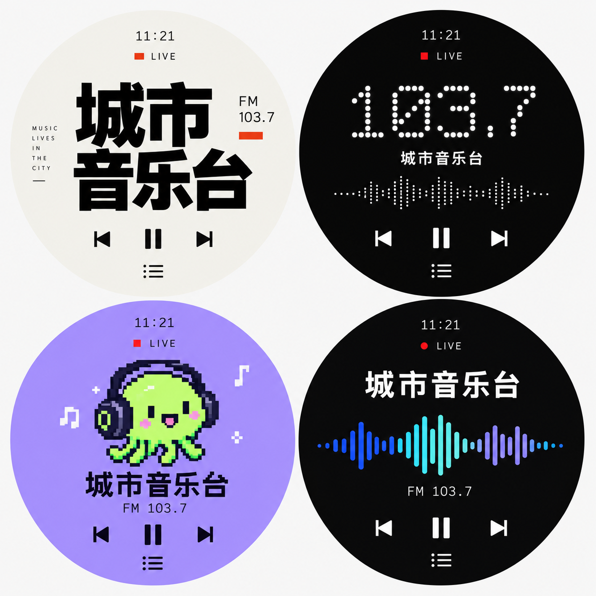
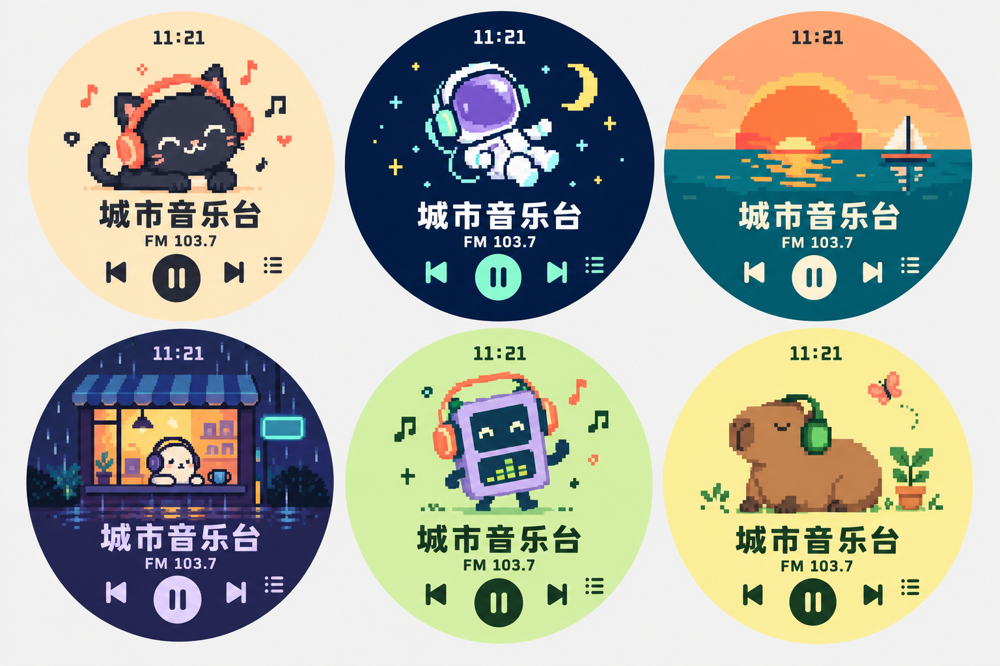

# 圆屏电台：十套风格档案

记录日期：2026-10-29。状态：**十套已接入 1.1.0-rc2 候选固件，尚待真机验收**。交付记录见 [RC2 说明](../../RADIO_V3_RC2.md)。

这份档案是本轮设计选择的项目内依据。后续修改保留现有编号；增加新版本用新文件，避免覆盖已经确认的参考图。

## 用户确认的方向

- 现代、清楚、有个性的平面图形；尤其喜欢像素角色与像素场景。
- 同一份固件支持切换风格，播放、台库和收藏共用。
- 允许用 AI 生成角色、场景和背景资产，不要求所有图形由 LVGL 原语手工绘制。
- 金属仪表、仿陶瓷、透明机芯和星图那批被否定，不纳入本次十套。
- 早期 HTML 的黑红点阵属于下面 S02 的设计前身，不额外算第十一套。该预览中用户指定的强调色为 `#D44A34`。

## 原始设计图

### 现代风四款

按左上、右上、左下、右下排列：

1. **S01 大字编辑风** · `editorial`：暖白底、黑色大字、朱红点缀。台名作为视觉主角。实现时须收拢边缘的装饰文字，并为不同长度台名预留布局；不要把「城市音乐台」做成固定字图。
2. **S02 点阵电波** · `dot-matrix`：黑底、白色点阵频率、小面积红色直播标记。延续先前确认的黑红点阵；频率和电平实时绘制。
3. **S03 像素主播** · `pixel-host`：淡紫底、绿色耳机角色。角色作为独立图像资产，台名、频率和按键单独叠加。
4. **S04 声波极简** · `sound-field`：黑底、清晰台名、蓝青紫声波。保留配色与构图，动态波形使用真实音频电平，避免用固定装饰伪装成实时信号。

### 像素风六款

按上排从左到右，再下排从左到右排列：

5. **S05 猫咪 DJ** · `cat-dj`：奶油杏色、黑猫、珊瑚色耳机。建议作为第一款像素风实装对象；后续可制作眨眼、听歌与暂停状态。
6. **S06 太空电波** · `space-signal`：深蓝底、宇航员、薄荷色操作区。后续可做局部漂浮与星点变化，优先保证台名清晰。
7. **S07 海边落日** · `seaside-sunset`：橘色夕阳、青绿海面、像素帆船。上部场景、下部纯净信息区；后续局部海浪动画。
8. **S08 雨夜便利店** · `rainy-shop`：靛蓝雨夜、暖色窗口、戴耳机角色。保留场景氛围，减小细节密度；雨滴动画不覆盖文字。
9. **S09 掌机音乐盒** · `pocket-player`：开心果绿、紫色机器人、珊瑚色耳机。后续表情与胸前电平联动。
10. **S10 像素花园** · `garden-capybara`：淡黄底、水豚、绿色耳机与盆栽。后续眨眼、蝴蝶和叶片微动。

十套都属于正式保留的设计方向；首批实现次序不代表删除或降级其余方案。默认开机皮肤尚未由用户指定，建议先沿用 S02，待真机比对后决定。

## 文件、来源与复现

- `modern-four.png`：原始现代风对比图，2 列 × 2 行，未裁切、未压缩替换。
- `pixel-six.png`：原始像素风对比图，3 列 × 2 行，未裁切、未压缩替换。
- `skins.json`：十套的稳定 ID、名称、参考图行列、素材状态与生成简述；便于后续工具读取。
- 生成方式：内置 ImageGen。现代风参考用户提供的 AI Passport 作品截图中的排版、点阵、像素角色及声波语言；当前项目内保存的是本轮生成结果。
- 现代风生成简述：四款正视圆形平面电台界面；编辑排版、黑白红点阵、紫绿像素主播、蓝青紫声波；台名与播放操作清晰；避免拟物材质。
- 像素风生成简述：六款正视圆形像素电台界面；猫咪、宇航员、落日海面、雨夜小店、掌机机器人、水豚花园；统一示例内容与操作；独立角色和场景，有限色板。
- `modern-four.png` SHA-256：`daa054598f4f81403da6016a55db1249791b600d5108bbd1532d6e2c73f0d410`。
- `pixel-six.png` SHA-256：`4cc668fc13ed85fdbd579bbcc20602562d28565a89abb1a819c0ab6ccf0352ef`。

## 参考图与交付资产的边界

这两张图用于确认视觉风格，**不是可直接烧录的十张 UI 底图**。示例文字、频率与图标均已画入图片，部分位置超出项目建议安全矩形；缩到 360×360 后也可能损失细节。实施时必须重新拆分与排版：

- 单独准备没有台名、频率、时钟和操作图标的角色／场景资产；不要把整张效果图直接铺底冒充动态界面。
- 台名、直播状态、连接状态、定时、频率、按钮由运行时绘制，支持中英文。
- 保持圆屏安全区与平台手势边界；不能照搬效果图边缘的列表键和装饰标签位置。
- 像素图按目标分辨率检查，避免任意比例缩放造成模糊；需要透明底时单独生成带 alpha 的资产。
- 动画是后续制作项，当前参考图只有静态图，不代表已拥有序列帧。

执行安排见 [固件实施计划](../../RADIO_V3_FIRMWARE_PLAN.md)。

2026-10-30 RC3：大字编辑风和点阵电波的修订前真机截图、修订后离线截图在 [rc3](rc3/)；诊断与验证边界见 [修订记录](../../RADIO_V3_RC3.md)。原始十套参考图继续保留。

